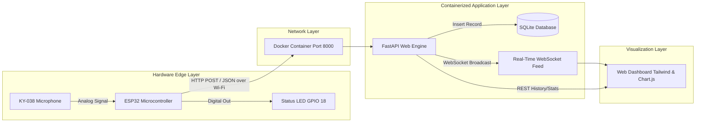

# IoT Project Report: Real-Time Sound Monitoring and Alert Telemetry System

---

## 1. Executive Summary
This project presents an end-to-end Internet of Things (IoT) acoustic monitoring and alert telemetry system. The architecture integrates an **ESP32 microcontroller** interfaced with a **KY-038 sound sensor module**, an active alert LED, a **containerized FastAPI backend (Docker)**, a persistent **SQLite relational database**, and an interactive **WebSocket-driven real-time web dashboard**.

---

## 2. System Architecture



### Complete End-to-End Data Flow
1. **Sensor Acquisition**: The KY-038 analog pin delivers voltage readings proportional to ambient sound pressure into ESP32 ADC pin 34.
2. **Local Edge Actuation**: When sound intensity exceeds the threshold ($960$), GPIO 18 activates the Green LED with a 600 ms hold window.
3. **Network Transmission**: ESP32 batches and transmits telemetry packets (`sound_level`, `threshold`, `led_state`, `device_id`) via HTTP `POST` requests to `/api/sensor-data`.
4. **Data Persistence**: The containerized FastAPI backend receives the JSON body, logs timestamps, and writes records into `iot_sensor.db`.
5. **Real-Time Visualization**: Ingested readings are pushed via WebSockets to connected browsers, updating telemetry charts and alert states in real time.

---

## 3. Hardware & Software Requirements

### Hardware Components
* **ESP32-WROOM-32** Development Board (30-pin or 38-pin).
* **KY-038 Microphone Sound Sensor Module** (or KY-037).
* **Green LED** with 220Ω / 330Ω current-limiting resistor.
* Breadboard and male-to-female / male-to-male jumper wires.
* Micro-USB cable for programming and power.

### Software Stack
* **Firmware**: Arduino C++ (ESP32 Core for Arduino).
* **Backend Framework**: Python 3.11+, FastAPI, Uvicorn, Pydantic.
* **Database**: SQLite3 (embedded, zero-configuration, ACID-compliant).
* **Containerization**: Docker, Docker Compose.
* **Frontend**: HTML5, Tailwind CSS, Chart.js, Vanilla JavaScript, WebSockets.

---

## 4. Hardware Wiring & Pinout Mapping

| Component Pin | ESP32 Pin | Function | Notes |
|---|---|---|---|
| KY-038 **AO** (Analog Out) | **GPIO 34** | ADC1_CH6 Input | Reads 12-bit analog voltage (0 – 4095) |
| KY-038 **VCC** | **3.3V / 5V** | Power Supply | 3.3V recommended for ADC compatibility |
| KY-038 **GND** | **GND** | Common Ground | Common return path |
| LED **Anode (+)** | **GPIO 18** | Digital Output | Controlled via current-limiting resistor |
| LED **Cathode (-)** | **GND** | Ground | Ground rail |

---

## 5. Database Schema Design

The SQLite database table `sensor_readings` captures all sensor events:

```sql
CREATE TABLE IF NOT EXISTS sensor_readings (
    id INTEGER PRIMARY KEY AUTOINCREMENT,
    sound_level INTEGER NOT NULL,
    threshold INTEGER NOT NULL,
    led_state INTEGER NOT NULL,
    device_id TEXT DEFAULT 'ESP32_KY038_Node',
    timestamp DATETIME DEFAULT CURRENT_TIMESTAMP
);
```

### Field Definitions
* `id`: Unique monotonically increasing integer identifying the reading event.
* `sound_level`: 12-bit ADC reading integer ($0 - 4095$).
* `threshold`: Configured detection threshold integer ($960$).
* `led_state`: Binary indicator ($1$ for alert/triggered, $0$ for quiet/normal).
* `device_id`: Telemetry node identifier string.
* `timestamp`: Formatted UTC time string recorded upon receipt.

---

## 6. Implementation Methodology

### 6.1 ESP32 Firmware (`code.ino`)
* Configured non-blocking timing with `millis()` for sensor sampling (every 5 ms), serial logging (200 ms), and HTTP network transmission (500 ms).
* Implemented automatic Wi-Fi reconnect handling if signal drops.
* JSON payload assembled and sent via `HTTPClient` with header `application/json`.

### 6.2 Containerized Backend (`backend/Dockerfile`, `docker-compose.yml`)
* FastAPI application packaged in a lightweight `python:3.11-slim` container.
* Volume mount `./data:/app/data` ensures SQLite database persistence across container restarts.
* Port 8000 mapped to host for incoming sensor telemetry and dashboard servicing.

### 6.3 Real-Time Dashboard (`backend/static/index.html`)
* Provides interactive KPI cards: Live Sound Level gauge, Threshold indicator, Alert state badge, and Aggregate statistics (Total, Max, Min, Alert count).
* Responsive line chart updating live via WebSocket.
* Live event audit log displaying the latest database records.

---

## 7. Testing & Verification

1. **Local & Container Testing**: Verified FastAPI endpoints (`/api/sensor-data`, `/api/sensor-data/history`, `/api/sensor-data/stats`, `/ws`).
2. **Sensor Simulation**: Verified with `simulate_sensor.py` providing simulated sensor waveforms, threshold violations, and WebSocket distribution.
3. **Dashboard Real-Time Response**: Verified instant update of Chart.js waveform upon incoming payload without browser refresh.
